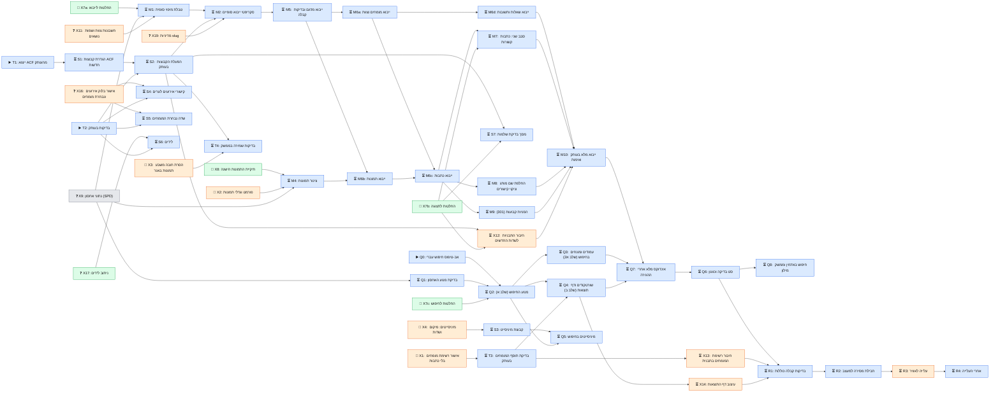

# MCity, תוכנית עבודה לפי תלויות (בלי משכי זמן)

נבנתה: 2026-11-22. **אין כאן משכי זמן ואין תאריכים.** יש רק סדר ותלויות: מה צריך להסתיים לפני מה. מחליפה את סדר השלבים והלוחות ב-`09-work-plan.md` (שנשאר כרקע לסיכונים).
נוצרה מהמסמכים 02 (נקודות פתוחות), 10 (הגירה), 11 (חיפוש) ו-12 (שדות).

## איך לקרוא

- **גל** = מספר השלבים הארוך ביותר של תלויות עד המשימה. גל 0 = אין לה תלות. משימה בגל N יכולה להתחיל רק כשכל תלויותיה, שנמצאות בגלים קודמים, הסתיימו. גלים אינם שבועות.
- **גורם:** אנחנו (modalix ai), מעצב, לקוח (דרך המעצב), אחסון (SPD).
- **סטטוס:** ✅ הושלם, ▶️ אפשר להתחיל עכשיו, ⏳ ממתין לתלויות, 📨 נשלח, ממתין לתשובה, ✍️ נוסח, טרם נשלח, ❓ פתוח, טרם התבקש.
- **משימות אופציונליות** (Q5, Q8) מסומנות בהערה. משימה חיצונית בגל 0 היא בקשה או החלטה שמישהו אחר צריך לספק.

## 1. מה אנחנו יכולים להתחיל עכשיו

משימות שלנו שכל תלויותיהן הושלמו:

- **T1** ייצוא ACF מהעותק: אימות שמות קבוצות ושדות מדויקים (ACF → Tools → Export).
- **T2** בדיקות בעותק: התנגשות מזהים (פוסט מול משתמש), תנאי Theme Builder, שמירת הגשות Elementor, טעינת JSON ב-ACF חינמי, משתמש צוות שסומן פעיל.
- **Q0** אב-טיפוס חיפוש עברי: נרמול עברית ואינדקס ניסיוני על נתוני הדאמפ המקומי.

## 2. מה חוסם אותנו: קלטים חיצוניים לפי כמות המשימות שהם פותחים

כל קלט חיצוני עם מספר המשימות (ישירות ובעקיפין) שתלויות בו. ככל שהמספר גדול, התשובה דחופה יותר.

| קלט | גורם | סטטוס | משימות שתלויות בו |
|---|---|---|---:|
| **X9** נתוני אחסון (SPD) | אחסון (SPD) | ❓ פתוח, טרם התבקש | 25 |
| **X7a** החלטות לייבוא | לקוח | 📨 נשלח, ממתין לתשובה | 18 |
| **X11** חשבונות צוות ושמות נושאים | מעצב | ❓ פתוח, טרם התבקש | 18 |
| **X19** מדיניות slug | מעצב | ❓ פתוח, טרם התבקש | 17 |
| **X2** פורמט וגדלי תמונות | מעצב | 📨 נשלח, ממתין לתשובה | 14 |
| **X8** תיקיית התמונות הישנה | לקוח | 📨 נשלח, ממתין לתשובה | 14 |
| **X7c** החלטות לחיפוש | לקוח | 📨 נשלח, ממתין לתשובה | 12 |
| **X1** אישור רשימת מומחים בלי כתבות | מעצב | 📨 נשלח, ממתין לתשובה | 11 |
| **X7b** החלטות לתצוגה | לקוח | 📨 נשלח, ממתין לתשובה | 11 |
| **X4** מיניסייטים: מיקום ושדות | מעצב | 📨 נשלח, ממתין לתשובה | 2 |
| **X16** אישור בלוק אירועים ונבחרת מומחים | מעצב | ❓ פתוח, טרם התבקש | 2 |
| **X3** הסרת חובה משבע תמונות באנר | מעצב | 📨 נשלח, ממתין לתשובה | 1 |
| **X17** ניתוב לידים | לקוח | ❓ פתוח, טרם התבקש | 1 |

## 3. לוח לפי גורם וגל (מעין גנט, בלי זמן)

| גל | אנחנו | מעצב | לקוח | אחסון (SPD) |
|---:|---|---|---|---|
| **0** | ✅**P1** מסמכי מיפוי, חיפוש ושדות ✅**P2** קוד רשימת מומחים פעילים ✅**P3** דאמפ MySQL של האתר הישן ✅**P4** עותק משלנו ופרטי גישה | 📨**X1** אישור רשימת מומחים בלי כתבות 📨**X2** פורמט וגדלי תמונות 📨**X3** הסרת חובה משבע תמונות באנר 📨**X4** מיניסייטים: מיקום ושדות ✅**X5** שדות כתבה (קרדיט, וידאו, הסתרת תאריך, קשורות) ❓**X11** חשבונות צוות ושמות נושאים ❓**X16** אישור בלוק אירועים ונבחרת מומחים ❓**X19** מדיניות slug | 📨**X7a** החלטות לייבוא 📨**X7b** החלטות לתצוגה 📨**X7c** החלטות לחיפוש 📨**X8** תיקיית התמונות הישנה ❓**X17** ניתוב לידים | ❓**X9** נתוני אחסון (SPD) |
| **1** | ▶️**T1** ייצוא ACF מהעותק ▶️**T2** בדיקות בעותק ⏳**T3** בדיקת תוסף המומחים בעותק ▶️**Q0** אב-טיפוס חיפוש עברי ✅**M2a** טיוטת סקריפטי ייבוא ⏳**S3** קבוצת מיניסייט ⏳**M1** טבלת מיפוי סופית ⏳**M4** צינור תמונות ⏳**Q1** בדיקת מנוע האחסון |  |  |  |
| **2** | ⏳**S1** הגדרת קבוצות ACF חדשות ⏳**S4** קישורי אירועים לערים ⏳**S5** שדה נבחרת המומחים ⏳**S6** לידים ⏳**Q2** מנוע החיפוש (שלב א) | ⏳**X13** חיבור רשימת המומחים בתבנית |  |  |
| **3** | ⏳**S2** הפעלת הקבוצות בעותק ⏳**Q3** עמודים ומונחים בחיפוש (שלב א2) ⏳**Q4** שורטקודים ודף תוצאות (שלב ב) ⏳**Q5** מיניסייטים בחיפוש |  |  |  |
| **4** | ⏳**T4** בדיקות שמירה בממשק ⏳**S7** מסך בדיקת שלמות ⏳**M2** סקריפטי ייבוא סופיים | ⏳**X12** חיבור התבניות לשדות החדשים ⏳**X14** עיצוב דף התוצאות |  |  |
| **5** | ⏳**M5** ייבוא מדגם ובדיקות קבלה |  |  |  |
| **6** | ⏳**M6a** ייבוא מומחים וצוות ⏳**M6b** ייבוא תמונות |  |  |  |
| **7** | ⏳**M6c** ייבוא כתבות ⏳**M6d** ייבוא שאלות ותשובות |  |  |  |
| **8** | ⏳**M7** סבב שני: כתבות קשורות ⏳**M8** החלפת שם מותג וניקוי קישורים ⏳**M9** הפניות קבועות (301) |  |  |  |
| **9** | ⏳**M10** ייבוא מלא בעותק ואימות |  |  |  |
| **10** | ⏳**Q7** אינדוקס מלא אחרי ההגירה |  |  |  |
| **11** | ⏳**Q6** סט בדיקה וכוונון |  |  |  |
| **12** | ⏳**Q8** חיפוש באדמין וממשק מילון ⏳**R1** בדיקות קבלה כוללות |  |  |  |
| **13** | ⏳**R2** חבילת מסירה למעצב |  |  |  |
| **14** |  | ⏳**R3** עלייה לאוויר |  |  |
| **15** | ⏳**R4** אחרי העלייה |  |  |  |

קריאה: שורה = גל, עמודה = גורם. כל משימה בגל N תלויה במשימה אחת לפחות בגל קודם. התלויות המדויקות בסעיף 5.

## 4. תרשים תלויות

חץ מ-X ל-Y = Y תלוי ב-X. צבע = גורם: כחול אנחנו, כתום מעצב, ירוק לקוח, אפור אחסון. מוצגות רק משימות שטרם הושלמו, וחיצים שמשתמעים מתלות אחרת הוסרו כדי שהתרשים יהיה קריא (הטבלה בסעיף 5 מלאה). מוצג ב-GitHub וב-WebStorm.

## 5. כל המשימות והתלויות

| # | גל | גורם | משימה | תלוי ב | סטטוס | הערה |
|---|---:|---|---|---|---|---|
| **P1** | 0 | אנחנו | **מסמכי מיפוי, חיפוש ושדות**: מסמכים 10, 11, 12 ויומן ההחלטות (עד החלטה 80) | אין | ✅ הושלם |  |
| **P2** | 0 | אנחנו | **קוד רשימת מומחים פעילים**: תוסף `src/mcx-experts-list`, נבדק בדמה בלבד | אין | ✅ הושלם | טרם נבדק בוורדפרס |
| **P3** | 0 | אנחנו | **דאמפ MySQL של האתר הישן**: התקבל (החלטה 64) | אין | ✅ הושלם | נשמר מחוץ לריפו |
| **P4** | 0 | אנחנו | **עותק משלנו ופרטי גישה**: `mcityportal.ussl.co.il` | אין | ✅ הושלם |  |
| **X1** | 0 | מעצב | **אישור רשימת מומחים בלי כתבות**: אישור ההצעה (כולל קבלת הקוד) לעמוד `/all_expert/` ולתתי-העמודים של הערים | אין | 📨 נשלח, ממתין לתשובה | נשלח 19.11 |
| **X2** | 0 | מעצב | **פורמט וגדלי תמונות**: איזה פורמט וכיווץ המעצב מעדיף לתמונות | אין | 📨 נשלח, ממתין לתשובה | נשלח 19.11 |
| **X3** | 0 | מעצב | **הסרת חובה משבע תמונות באנר**: שינוי שדה קיים: 7 שדות תמונת הבאנר של מומחה (מסמך 12 סעיף 4) | אין | 📨 נשלח, ממתין לתשובה | נשלח 19.11 |
| **X4** | 0 | מעצב | **מיניסייטים: מיקום ושדות**: אותו וורדפרס או דומיין נפרד, ורשימת השדות שהוא בונה | אין | 📨 נשלח, ממתין לתשובה | נשלח 19.11. המעצב בונה אותם, כנראה בשבוע הקרוב |
| **X5** | 0 | מעצב | **שדות כתבה (קרדיט, וידאו, הסתרת תאריך, קשורות)**: לא נדרש: האתר החדש לא משתמש בשדות האלה (מעצב, 24.11). התאריך מוצג רק בכתבות חדשותיות | אין | ✅ הושלם | נסגר 24.11. הנתונים נשמרים כמטא פרטית בלבד |
| **X7a** | 0 | לקוח | **החלטות לייבוא**: שנת חתך, מנויים שפגו, בורסה ונדל"ן, תוכן שיווקי (כ-2,700), תת-אזורים בחדשות (12 מדורים), כלל שם מותג, מיילים משותפים של 65 מומחים, שאלות פורום | אין | 📨 נשלח, ממתין לתשובה | נשלח 19.11 דרך המעצב |
| **X7b** | 0 | לקוח | **החלטות לתצוגה**: הצגת תאריך, כתבות קשורות (ידני/אוטומטי), קישורים בכרטיס מומחה (8/12), תווית אזור שירות, אורך מינימלי לביוגרפיה | אין | 📨 נשלח, ממתין לתשובה | נשלח 19.11 דרך המעצב |
| **X7c** | 0 | לקוח | **החלטות לחיפוש**: גוף מלא או תקציר, תוכן שיווקי בחיפוש, מומחה לא פעיל בחיפוש, דירוג, חיפוש באדמין | אין | 📨 נשלח, ממתין לתשובה | נשלח 19.11 דרך המעצב |
| **X8** | 0 | לקוח | **תיקיית התמונות הישנה**: `/files_media/` מהאתר הישן (הדאמפ מכיל מטא-דאטה בלבד) | אין | 📨 נשלח, ממתין לתשובה | דורש גם רשות הוצאה מהאחסון (X9) |
| **X9** | 0 | אחסון (SPD) | **נתוני אחסון (SPD)**: SSH ו-WP-CLI, מכסות אחסון וזמן ריצה, גרסת MySQL, רשות להוציא תמונות, טבלת הערים של הדאמפ | אין | ❓ פתוח, טרם התבקש | דרך מי שמחזיק את החשבון |
| **X11** | 0 | מעצב | **חשבונות צוות ושמות נושאים**: משתמשים 1 ו-6 ומשתמש הכתבות בלי כותב, ושמות תצוגה של הנושאים | אין | ❓ פתוח, טרם התבקש |  |
| **X16** | 0 | מעצב | **אישור בלוק אירועים ונבחרת מומחים**: אישור CPT לבלוק האירועים ושדה user על מונחי הערים (שינוי תבנית) | אין | ❓ פתוח, טרם התבקש | מעצב ולקוח |
| **X17** | 0 | לקוח | **ניתוב לידים**: לאן הפניות נשמרות ולאיזה מייל הן נשלחות (עורך האזור?) | אין | ❓ פתוח, טרם התבקש |  |
| **X19** | 0 | מעצב | **מדיניות slug**: כתובות בעברית או באנגלית (translit) | אין | ❓ פתוח, טרם התבקש | אנחנו והמעצב |
| **T1** | 1 | אנחנו | **ייצוא ACF מהעותק**: אימות שמות קבוצות ושדות מדויקים (ACF → Tools → Export) | P4 | ▶️ אפשר להתחיל עכשיו |  |
| **T2** | 1 | אנחנו | **בדיקות בעותק**: התנגשות מזהים (פוסט מול משתמש), תנאי Theme Builder, שמירת הגשות Elementor, טעינת JSON ב-ACF חינמי, משתמש צוות שסומן פעיל | P4 | ▶️ אפשר להתחיל עכשיו |  |
| **T3** | 1 | אנחנו | **בדיקת תוסף המומחים בעותק**: התקנה ובדיקה לפי רשימת הבדיקות ב-README של התוסף | P2, X1 | ⏳ ממתין לתלויות |  |
| **Q0** | 1 | אנחנו | **אב-טיפוס חיפוש עברי**: נרמול עברית ואינדקס ניסיוני על נתוני הדאמפ המקומי | P1, P3 | ▶️ אפשר להתחיל עכשיו | אפשר להתחיל בלי החלטות |
| **M2a** | 1 | אנחנו | **טיוטת סקריפטי ייבוא**: חבילת `src/migration`: מומחים, כתבות, פורום, מדורים ודוח, נבדקה מול הדאמפ (40 בדיקות), בלי כתיבה לאתר | P1, P3 | ✅ הושלם | הושלם 22-24.11. הטוען לוורדפרס עוד לא נכתב |
| **S3** | 1 | אנחנו | **קבוצת מיניסייט**: לפי השדות שהמעצב בונה | X4 | ⏳ ממתין לתלויות | מוקפא עד אז |
| **M1** | 1 | אנחנו | **טבלת מיפוי סופית**: ערים, מדורים, נושאים, תת-אזורים (כולל טבלת הערים של הדאמפ ושמות הנושאים) | P1, X7a, X9, X11 | ⏳ ממתין לתלויות |  |
| **M4** | 1 | אנחנו | **צינור תמונות**: ספירה מול הקבצים, כיווץ והסרת כפילויות | X8, X2, X9 | ⏳ ממתין לתלויות |  |
| **Q1** | 1 | אנחנו | **בדיקת מנוע האחסון**: גרסת MySQL, FULLTEXT ואורך מילה מינימלי | X9 | ⏳ ממתין לתלויות |  |
| **S1** | 2 | אנחנו | **הגדרת קבוצות ACF חדשות**: קבוצת פרופיל מומחה כקובץ JSON (קבוצת הכתבה לא נדרשת, X5). מסירת שמות שדות מדויקים | T1, X5 | ⏳ ממתין לתלויות |  |
| **S4** | 2 | אנחנו | **קישורי אירועים לערים**: בלוק אירועים לכ-20 ערים | X16, T2 | ⏳ ממתין לתלויות |  |
| **S5** | 2 | אנחנו | **שדה נבחרת המומחים**: שדה user מרובה (עד 8) על מונחי הערים | X16, T2 | ⏳ ממתין לתלויות |  |
| **S6** | 2 | אנחנו | **לידים**: טופס Elementor, שמירת הגשות, הפניה למייל | X17, T2 | ⏳ ממתין לתלויות |  |
| **X13** | 2 | מעצב | **חיבור רשימת המומחים בתבנית**: שורטקוד או שאילתה ב-`/all_expert/` | T3 | ⏳ ממתין לתלויות |  |
| **Q2** | 2 | אנחנו | **מנוע החיפוש (שלב א)**: נרמול עברית, טבלת אינדקס, שאילתה, REST | Q0, Q1, X7c | ⏳ ממתין לתלויות |  |
| **S2** | 3 | אנחנו | **הפעלת הקבוצות בעותק**: טעינה, וכתיבה וקריאה של כל שדה חדש | S1, T2 | ⏳ ממתין לתלויות |  |
| **Q3** | 3 | אנחנו | **עמודים ומונחים בחיפוש (שלב א2)**: כולל בדיקה אם תוכן Elementor ניתן לחילוץ | Q2 | ⏳ ממתין לתלויות |  |
| **Q4** | 3 | אנחנו | **שורטקודים ודף תוצאות (שלב ב)**: `[mc_search_*]`, Query ID, דף תוצאות | Q2, T3 | ⏳ ממתין לתלויות |  |
| **Q5** | 3 | אנחנו | **מיניסייטים בחיפוש**: רק אם יוחלט, אחרי השדות | S3, Q2 | ⏳ ממתין לתלויות | אופציונלי |
| **T4** | 4 | אנחנו | **בדיקות שמירה בממשק**: `phone` עם אפס מוביל, שמירת מומחה עם `required` של באנרים, אין התנגשות שמות | S2, X3 | ⏳ ממתין לתלויות |  |
| **S7** | 4 | אנחנו | **מסך בדיקת שלמות**: מסך אדמין שמסמן מומחה פעיל עם פרטים חסרים | S2, X7b | ⏳ ממתין לתלויות |  |
| **M2** | 4 | אנחנו | **סקריפטי ייבוא סופיים**: התאמה לשדות החדשים ולהחלטות. ניתנים להרצה חוזרת | M2a, M1, S2, X19 | ⏳ ממתין לתלויות |  |
| **X12** | 4 | מעצב | **חיבור התבניות לשדות החדשים**: פתיח, קרדיט, תאריך, טלפון, תווית אזור, אימייל, דגל תשלום | S2, X7b | ⏳ ממתין לתלויות |  |
| **X14** | 4 | מעצב | **עיצוב דף התוצאות**: CSS לכרטיסי התוצאות והטופס | Q4 | ⏳ ממתין לתלויות |  |
| **M5** | 5 | אנחנו | **ייבוא מדגם ובדיקות קבלה**: כ-200 כתבות ו-20 מומחים, לפי טבלת הבדיקות במסמך 10. גם כיול הערכת הזמן | M2 | ⏳ ממתין לתלויות | לפני כל ריצה: גיבוי UpdraftPlus |
| **M6a** | 6 | אנחנו | **ייבוא מומחים וצוות**: כולל תחומים, ערים, פרטי קשר | M5, X7a | ⏳ ממתין לתלויות |  |
| **M6b** | 6 | אנחנו | **ייבוא תמונות**: לפי צינור התמונות | M5, M4 | ⏳ ממתין לתלויות |  |
| **M6c** | 7 | אנחנו | **ייבוא כתבות**: שיוך עיר ונושא, מדורים ותת-אזורים | M6a, M6b | ⏳ ממתין לתלויות |  |
| **M6d** | 7 | אנחנו | **ייבוא שאלות ותשובות**: לפי מדיניות הפורום שתיקבע | M6a, X7a | ⏳ ממתין לתלויות |  |
| **M7** | 8 | אנחנו | **סבב שני: כתבות קשורות**: מיפוי מזהה ישן למזהה חדש | M6c, X7b | ⏳ ממתין לתלויות |  |
| **M8** | 8 | אנחנו | **החלפת שם מותג וניקוי קישורים**: בתוכן המיובא | M6c, X7a | ⏳ ממתין לתלויות |  |
| **M9** | 8 | אנחנו | **הפניות קבועות (301)**: מיפוי כתובת ישנה לחדשה וייבוא ל-Redirection | M6c, X19 | ⏳ ממתין לתלויות | הפעלה בפועל רק בעלייה |
| **M10** | 9 | אנחנו | **ייבוא מלא בעותק ואימות**: ספירות מול המקור, דגימה ידנית, בדיקת תצוגה בתבניות | M6c, M6d, M7, M8, M9, X12 | ⏳ ממתין לתלויות |  |
| **Q7** | 10 | אנחנו | **אינדוקס מלא אחרי ההגירה**: בנייה אחת בסוף, ובדיקת ביצועים | M10, Q3, Q4 | ⏳ ממתין לתלויות |  |
| **Q6** | 11 | אנחנו | **סט בדיקה וכוונון**: כ-40 שאילתות עם הלקוח, מילון נרדפים, משקלים | Q7, X7c | ⏳ ממתין לתלויות |  |
| **Q8** | 12 | אנחנו | **חיפוש באדמין וממשק מילון**: אופציונלי, לפי החלטת הלקוח | Q6, X7c | ⏳ ממתין לתלויות | אופציונלי |
| **R1** | 12 | אנחנו | **בדיקות קבלה כוללות**: כתבות, מומחים פעילים ולא פעילים, 301, מיילים, חיפוש | M10, Q6, X13, X14 | ⏳ ממתין לתלויות |  |
| **R2** | 13 | אנחנו | **חבילת מסירה למעצב**: קובצי JSON, תוסף, סקריפטים, הוראות הרצה ורשימת בדיקות | R1, S2 | ⏳ ממתין לתלויות |  |
| **R3** | 14 | מעצב | **עלייה לאוויר**: ניקוי חשבונות בדיקה, הסרת Novamira וכלי פיתוח, מטמון ואחסון (באחריות המעצב, החלטה 73) | R2 | ⏳ ממתין לתלויות |  |
| **R4** | 15 | אנחנו | **אחרי העלייה**: הפעלת 301, Search Console, אינדוקס מחדש ואימות | R3, M9 | ⏳ ממתין לתלויות | עם המעצב |

## 6. השרשרת הארוכה ביותר

הרצף הארוך ביותר של משימות תלויות זו בזו. שום דבר ממנו לא יכול לרוץ במקביל לעצמו, ולכן כל עיכוב בחוליה בו מעכב את הסוף. אורכו נמדד **בכמות חוליות, לא בזמן**.

**P4** עותק משלנו ופרטי גישה → **T1** ייצוא ACF מהעותק → **S1** הגדרת קבוצות ACF חדשות → **S2** הפעלת הקבוצות בעותק → **M2** סקריפטי ייבוא סופיים → **M5** ייבוא מדגם ובדיקות קבלה → **M6a** ייבוא מומחים וצוות → **M6c** ייבוא כתבות → **M7** סבב שני: כתבות קשורות → **M10** ייבוא מלא בעותק ואימות → **Q7** אינדוקס מלא אחרי ההגירה → **Q6** סט בדיקה וכוונון → **R1** בדיקות קבלה כוללות → **R2** חבילת מסירה למעצב → **R3** עלייה לאוויר → **R4** אחרי העלייה

אורך: 16 חוליות.

## 7. מה לא כלול ולמה

- **בניית המיניסייטים** נעשית על ידי המעצב (לא שלנו). אצלנו רק S3 ו-Q5, אחרי שהוא מגדיר שדות.
- **עיצוב ותבניות** הם של המעצב. מופיעים רק מקומות שבהם אנחנו תלויים בהם (X12, X13, X14).
- **הערכות זמן** הוסרו בכוונה. אחרי M5 (ייבוא מדגם) אפשר לכייל הערכה על נתונים אמיתיים.
- **פרודקשן:** העלייה לאוויר באחריות המעצב (R3). אצלנו מסירת החבילה (R2) והמשך אחרי העלייה (R4).
- **מקור הסטטוס:** מצב הבקשות מבוסס על יומן ההחלטות (החלטה 77, 19.11). X5 נסגר ב-24.11 (השדות לא נדרשים). X7a נענה חלקית ב-24.11 (חתך 2015, שיווק, פורום), נשאר: מומחים לא פעילים, מנוי שפג, שם מותג, מיילים משותפים (הלקוח ימלא). X9, X11, X16, X17 ו-X19 נשארו פתוחים לפי נקודות פתוחות במסמך 02 ובמסמך 10 סעיף 12.
